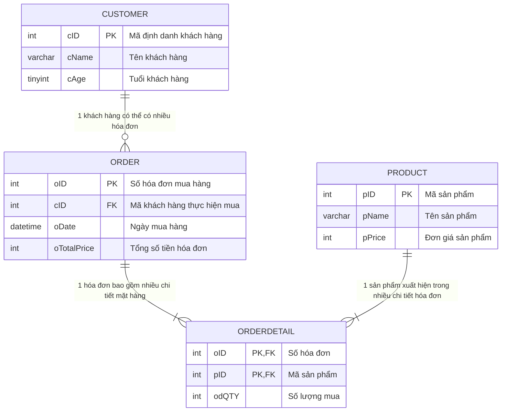

# Bài Tập: Xây Dựng Cơ Sở Dữ Liệu Quản Lý Bán Hàng (QuanLyBanHang)

Dự án thiết kế và cài đặt cơ sở dữ liệu quan hệ **QuanLyBanHang** bằng MySQL, quản lý thông tin khách hàng, hóa đơn, danh mục sản phẩm và chi tiết mua hàng.

---

## 1. Mô Hình Thực Thể & Sơ Đồ ERD



---

## 2. Cấu Trúc Bảng & Ràng Buộc Toàn Vẹn (Schema Definition)

### 2.1. Bảng `Customer` (Khách hàng)
Lưu trữ danh sách khách hàng đến cửa hàng (cả khách có mua hàng và khách chưa mua hàng).
* `cID`: `INT AUTO_INCREMENT PRIMARY KEY` - Mã khách hàng.
* `cName`: `VARCHAR(50) NOT NULL` - Tên khách hàng.
* `cAge`: `TINYINT NOT NULL` kèm ràng buộc `CHECK (cAge > 0 AND cAge <= 120)` - Tuổi khách hàng hợp lệ.

### 2.2. Bảng `` `Order` `` (Hóa đơn)
Mỗi khách hàng khi mua hàng sẽ được tạo một hóa đơn mua hàng.
* `oID`: `INT AUTO_INCREMENT PRIMARY KEY` - Số hóa đơn.
* `cID`: `INT NOT NULL` - Khóa ngoại tham chiếu tới `Customer(cID)`.
* `oDate`: `DATETIME NOT NULL` - Ngày lập hóa đơn.
* `oTotalPrice`: `INT NULL` - Tổng số tiền của hóa đơn.

### 2.3. Bảng `Product` (Sản phẩm)
Danh mục các mặt hàng được bán tại cửa hàng.
* `pID`: `INT AUTO_INCREMENT PRIMARY KEY` - Mã sản phẩm.
* `pName`: `VARCHAR(50) NOT NULL` - Tên sản phẩm.
* `pPrice`: `INT NOT NULL` kèm ràng buộc `CHECK (pPrice >= 0)` - Giá tiền sản phẩm.

### 2.4. Bảng `OrderDetail` (Chi tiết hóa đơn)
Lưu trữ danh sách các mặt hàng trong từng hóa đơn, số lượng mỗi loại.
* `oID`: `INT NOT NULL` - Khóa ngoại tham chiếu tới `Order(oID)`.
* `pID`: `INT NOT NULL` - Khóa ngoại tham chiếu tới `Product(pID)`.
* `odQTY`: `INT NOT NULL` kèm ràng buộc `CHECK (odQTY > 0)` - Số lượng sản phẩm mua.
* **Khóa chính phức hợp**: `PRIMARY KEY (oID, pID)`.

---

## 3. Các Truy Vấn Nghiệp Vụ Mẫu

Tệp [`QuanLyBanHang.sql`](./QuanLyBanHang.sql) bao gồm đầy đủ 4 câu truy vấn nghiệp vụ chuẩn mực:

1. **Hiển thị thông tin hóa đơn (oID, oDate, oTotalPrice):**
   ```sql
   SELECT oID, oDate, oTotalPrice FROM `Order`;
   ```

2. **Hiển thị khách hàng và danh sách sản phẩm đã mua:**
   ```sql
   SELECT c.cName, p.pName, od.odQTY
   FROM Customer c
   JOIN `Order` o ON c.cID = o.cID
   JOIN OrderDetail od ON o.oID = od.oID
   JOIN Product p ON od.pID = p.pID
   ORDER BY c.cName;
   ```

3. **Hiển thị khách hàng không mua bất kỳ sản phẩm nào:**
   ```sql
   SELECT c.cID, c.cName, c.cAge
   FROM Customer c
   LEFT JOIN `Order` o ON c.cID = o.cID
   WHERE o.oID IS NULL;
   ```

4. **Tính tổng tiền của từng hóa đơn:**
   ```sql
   SELECT o.oID, o.oDate, SUM(od.odQTY * p.pPrice) AS TotalPrice
   FROM `Order` o
   JOIN OrderDetail od ON o.oID = od.oID
   JOIN Product p ON od.pID = p.pID
   GROUP BY o.oID, o.oDate;
   ```

---

## 4. Hướng Dẫn Thực Thi

Mở **MySQL Workbench** hoặc **MySQL Command Line Client**:
```bash
mysql -u root -p < QuanLyBanHang.sql
```
Toàn bộ CSDL `QuanLyBanHang`, 4 bảng, các ràng buộc toàn vẹn, dữ liệu mẫu và các câu truy vấn sẽ được khởi tạo tự động.
